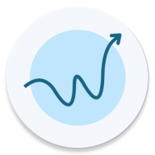
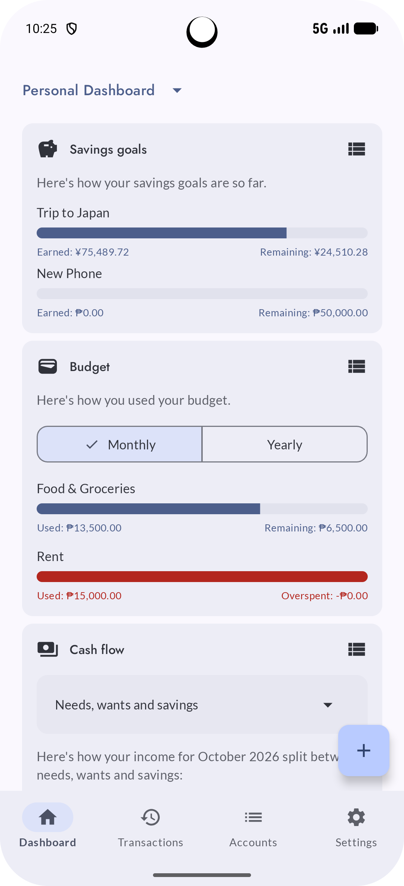
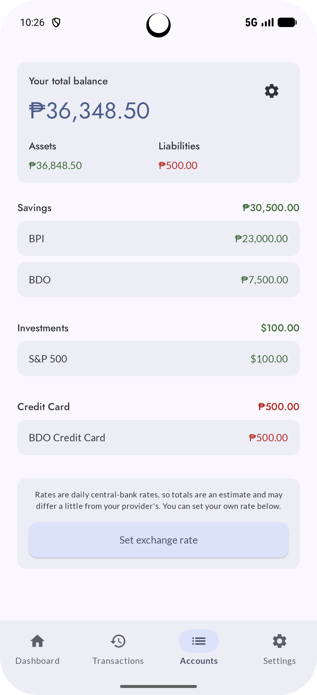
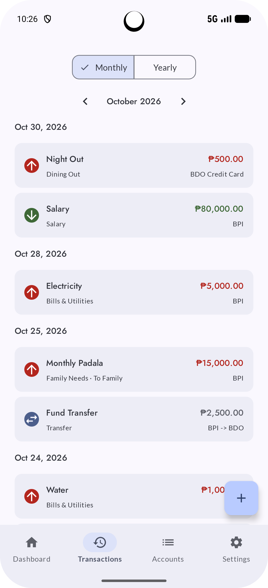
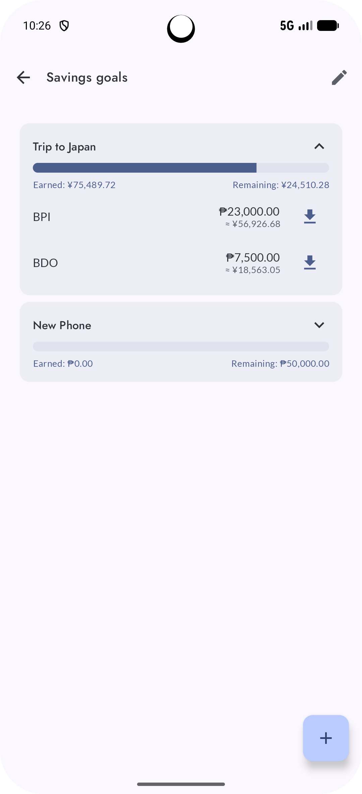
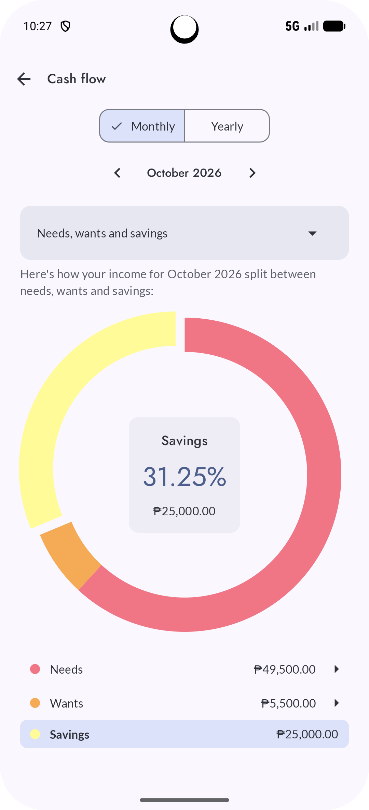
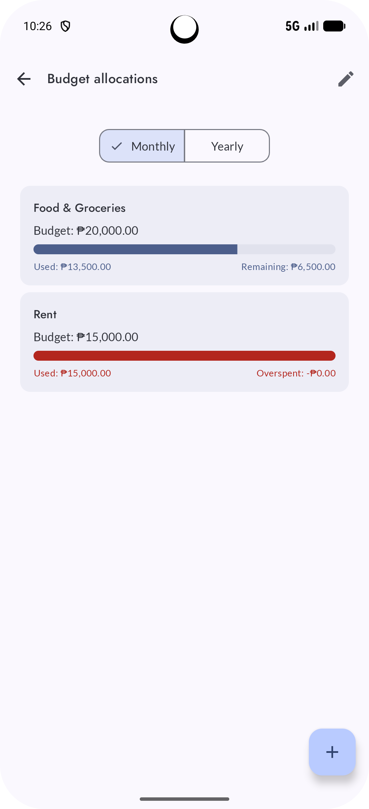
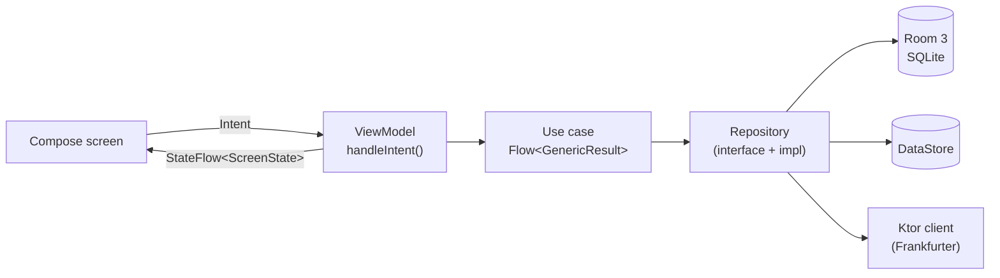
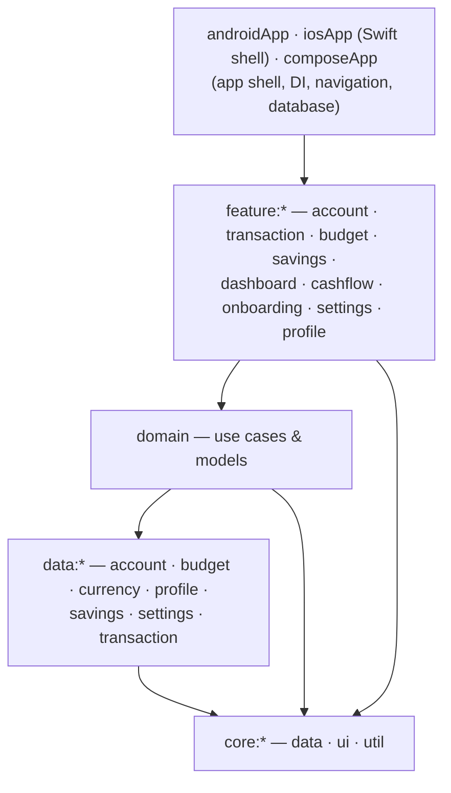

<p align="center">
  
</p>

<h1 align="center">Wais: Budget Tracker App</h1>

<p align="center"><em>Being wais with your money just got easy.</em></p>
<p align="center"><em>Official site: https://wais.jolotan.com</p>

<p align="center">
  
  
  
  
</p>

---

## At a glance

**Wais** (from the Filipino slang *wais*, meaning "smart" or "savvy") is a personal finance app built with
**Kotlin Multiplatform** and **Compose Multiplatform**. One shared codebase gives native apps for Android, iOS
and Desktop. It is built mainly for Filipinos who juggle several accounts, currencies and households, and it is
**offline-first and privacy-first**: there are no user accounts and no backend, and all financial data stays on
the device.

| Platform | Version | Distribution |
|---|---|---|
| Android | 0.1.2 | Google Play internal testing (closed beta) |
| iOS | 0.1.1 | TestFlight internal testing (closed beta) |
| Desktop (JVM) | – | Builds and runs, not yet released |

> **About the source code:** the app's source lives in a private repository. This public repo holds the
> project overview, architecture notes, an AI-usage disclosure, and the code for the Wais landing website.
> If you're a recruiter or hiring manager and want a walkthrough or read access, email me at
> [jolotan416@gmail.com](mailto:jolotan416@gmail.com).

## Screenshots

<table>
  <tr>
    <td align="center"><br/>Dashboard</td>
    <td align="center"><br/>Accounts</td>
    <td align="center"><br/>Transactions</td>
  </tr>
  <tr>
    <td align="center"><br/>Savings goals</td>
    <td align="center"><br/>Cash flow</td>
    <td align="center"><br/>Budget Allocation</td>
  </tr>
</table>

## Features

- **Multiple profiles.** Keep separate books for things like *Personal* and *Household*, each with its own main currency. A transfer between profiles creates a linked expense and income pair.
- **Multi-currency.** Daily exchange rates for 165 currencies, cached offline. You can refresh on demand or pin a manual rate.
- **Categories and budgets.** Categories are user-defined and tied to a transaction type. Each category can have a monthly or yearly budget, and usage shows on the dashboard.
- **Savings goals.** Each goal is backed by one or more accounts and has a priority. Progress is computed from live balances, never stored. You can withdraw all or part of a goal and clone one that has been used up.
- **Cash flow.** Expense and income breakdowns by category, plus a Needs / Wants / Savings chart in the spirit of the 50-30-20 rule.
- **Guided onboarding** for each profile, covering main currency, default account groups, accounts and categories.
- **Accounts and account groups.** Each account has its own currency. Accounts can be dragged between groups and reordered. Total balance is split into assets and liabilities and converted to your main currency.
- **Transactions.** Types are Need, Want, Income, Transfer and "To another profile". History is grouped by date with month and year navigation, and cross-currency transfers record the amount actually received.
- **Recurring transactions.** Weekly, monthly or yearly, with a start date and an optional end. Due occurrences are generated automatically for every profile.
- **Opt-in analytics.** Analytics and crash reporting are off until the user agrees, and events never contain financial data.

## Architecture

Clean Architecture with **MVVM + MVI-style intents** and unidirectional data flow, reactive end to end with
Kotlin `Flow`. Nearly all code lives in `commonMain`.



The app is split into **22 Gradle modules**. Dependencies only point downward, and `data:*` modules never depend on each other.



Shared build configuration lives in `build-logic` convention plugins (`budgettracker.kmp.library` and
`budgettracker.kmp.compose.library`), so a new module needs only a few lines of Gradle.

➡️ Full details in **[docs/ARCHITECTURE.md](docs/ARCHITECTURE.md)**.

## Tech stack

| Area | Technology |
|---|---|
| Language | Kotlin 2.4 (KSP 2), JVM target 21 |
| UI | Compose Multiplatform 1.12, Material 3, custom design system with the Styles API |
| Navigation | Navigation 3 + Material 3 adaptive navigation |
| Architecture | Clean Architecture, MVVM/MVI, unidirectional data flow, AndroidX Lifecycle ViewModel |
| Dependency injection | Koin 4.2 |
| Persistence | Room 3 (bundled SQLite), DataStore Preferences |
| Networking | Ktor 3.6 (OkHttp on Android, Darwin on iOS), kotlinx.serialization |
| Async | Kotlin Coroutines and Flow |
| Other libraries | kotlinx-datetime, Kermit logging |
| Firebase | Analytics, Crashlytics (mobile only, opt-in), Hosting |
| Build | Gradle with convention plugins, AGP 9, version catalogs |
| Testing | kotlin.test, kotlinx-coroutines-test, Ktor MockEngine, Room MigrationTestHelper |
| Targets | Android (minSdk 26, targetSdk 37), iOS (arm64 and simulator), Desktop JVM (DMG/MSI/DEB) |

## Engineering highlights

| What | Why it matters |
|---|---|
| **Savings-goal allocation as a max-flow problem.** When goals share accounts, an augmenting-path algorithm on a goal↔account bipartite graph funds goals in priority order. | Each goal gets the most it can without taking money from a higher-priority goal, and allocations stay stable between refreshes. |
| **Offline-first persistence with Room 3** (bundled SQLite) and DataStore. Schemas are exported, and every schema version bump ships with a migration test. | User data survives app updates on every platform without a backend. |
| **Exchange-rate caching.** One base-currency fetch per day yields every currency pair. Failed fetches back off, requests time out, and manual rates survive a refresh. | Fast and works offline. Building needs no API keys, because the free [Frankfurter](https://frankfurter.dev) API replaced a keyed provider whose terms didn't fit. |
| **Consent-gated analytics with two safeguards.** A single consent value controls both Firebase SDKs (off by default in the manifest and Info.plist), and a gated tracker re-checks consent before every event. | Privacy by design: analytics events never contain amounts, names, categories or currencies. |
| **Profile data scoping.** Only three root tables store a profile id; every other row inherits its profile through what it references. Reserved rows use negative ids, and switching profiles resets the navigation and form state. | Data can't leak between profiles, and it can't be saved into the wrong one mid-edit. |
| **Navigation 3.** The backstack is serializable, ViewModels are scoped to each navigation entry, and selector screens return values through a result store, so routes contain no lambdas. | The app restores correctly after process death and configuration changes. |
| **Error-state audit.** Every screen that can realistically fail was checked, and the remaining gaps are documented along with the reason each is acceptable. | The app fails predictably when it is offline or a rate is missing. |
| **Independent per-platform releases.** Each platform has its own versioning and changelog. Release signing comes from local or CI properties, and a release build never falls back to the debug key. | Android and iOS can ship on their own schedules. |

## Built by me, with AI assistance

I designed and built Wais. I set up the **initial architecture, module structure, infrastructure and design
conventions myself** (Oct 2025 – Feb 2026, 74 commits with no AI involvement). I started using
**Claude Code** in March 2026, once the infrastructure and design philosophy were stable.

Since then I have used Claude Code as a pair programmer. I set the scope and steer the design, Claude
implements, and **I review every diff** before committing and merging. I also wrote project-specific
**Claude skills** that encode my architecture and UI conventions, so generated code stays in line with them.
About 45% of non-merge commits carry a Claude co-author trailer.

➡️ The full, evidence-based breakdown is in **[docs/AI_ASSISTED_DEVELOPMENT.md](docs/AI_ASSISTED_DEVELOPMENT.md)**.

## Project in numbers

| | |
|---|---|
| Development period | October 2025 – present |
| Gradle modules | 22 |
| Kotlin source | ~322 files, ~28,900 lines |
| Automated tests | 104 tests in 20 files |
| Commits / merged PRs | 342 / 26 |
| Design and technical docs | ~2,700 lines of Markdown, with Mermaid diagrams |

## Roadmap

Planned for the public v1 release:

- Over-budget alerts and notifications
- Data export and backup
- Transaction search
- Filipino localization
- Home-screen widgets
- GCash / Maya transaction capture
- *Utang* (debt) and *paluwagan* (rotating savings) tracking

## About this repository

Besides the documentation, this repo contains the **Wais landing website**. It is built with Compose
Multiplatform for the Web and targets Kotlin/Wasm, with a JS fallback.

- [`shared/`](shared/src) contains the shared UI (atomic-design components, theme and styles).
- [`webApp/`](webApp/src) is the web entry point.

Run it locally:

```shell
# Wasm target (faster, modern browsers)
./gradlew :webApp:wasmJsBrowserDevelopmentRun

# JS target (slower, supports older browsers)
./gradlew :webApp:jsBrowserDevelopmentRun
```

## Contact

- **GitHub:** [@jolotan416](https://github.com/jolotan416)
- **Recruiters and hiring managers:** [jolotan416@gmail.com](mailto:jolotan416@gmail.com)
- **App issues and feature requests:** [jolotan.support@gmail.com](mailto:jolotan.support@gmail.com)
- **Privacy policy:** [wais.jolotan.com/privacy.html](https://wais.jolotan.com/privacy.html)

© Jolo Tan. All rights reserved.
