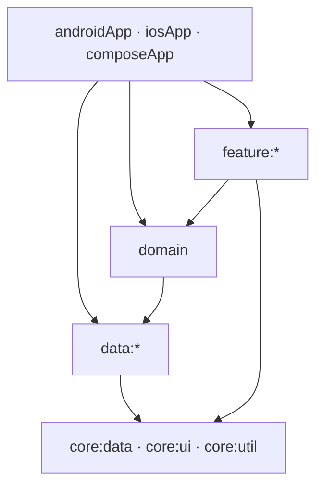
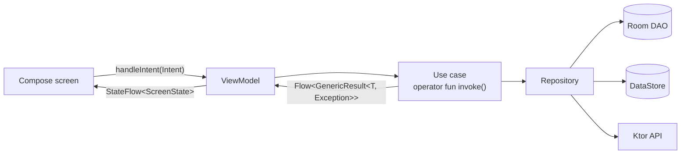
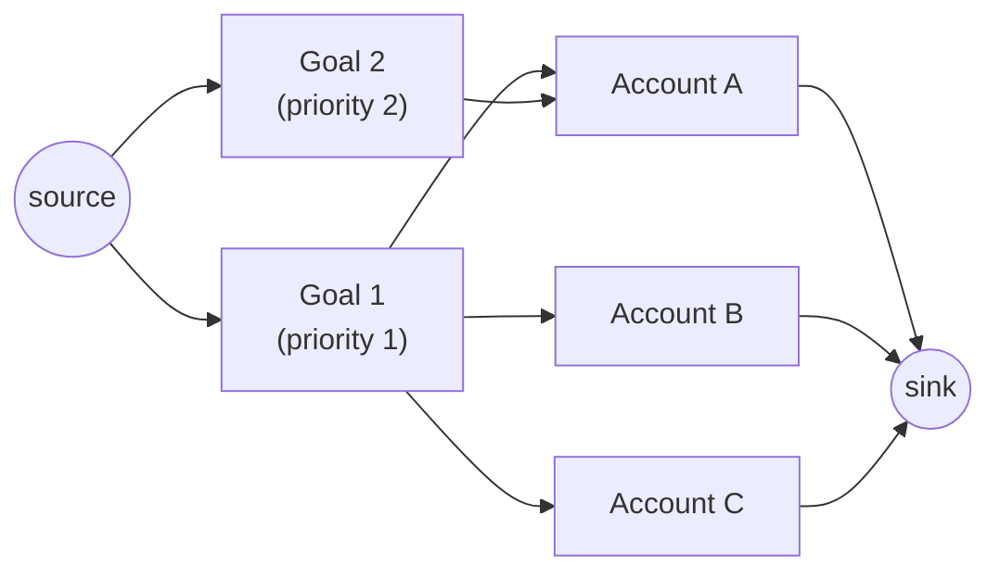

# Wais architecture

This document describes how the Wais app is built. The app's source is private, so this is a written
overview rather than a link to the code. Back to the [README](../README.md).

## 1. Overview

Wais is a **Kotlin Multiplatform** app. One **Compose Multiplatform** UI is shared across Android, iOS and
Desktop (JVM). Almost all code lives in `commonMain`. The platform source sets (`androidMain`, `iosMain`,
`jvmMain`) contain only thin bindings, such as Firebase on mobile and no-op implementations on Desktop.

Guiding principles:

- **Offline-first and privacy-first.** There are no user accounts and no backend. Financial data lives
  only in the on-device database. The only network call fetches exchange rates.
- **Clean Architecture with unidirectional data flow.** State flows towards UI, intents flow towards the database/backend, and every layer
  talks to the one below it through `Flow`.
- **Strict module boundaries.** Dependencies only point downward, and feature or data modules never
  depend on their siblings.

## 2. Modules

The app has 22 Gradle modules, plus an included `build-logic` build.

| Module | Responsibility |
|---|---|
| `androidApp` | Android application: Firebase Analytics and Crashlytics, release signing, R8 |
| `iosApp` | Swift entry point, Firebase bindings, separate Debug ("Wais Dev") and Release apps |
| `composeApp` | Shared app shell: Navigation 3 routes and backstack, Koin setup, Room database, analytics gate, Desktop `main`, iOS framework |
| `feature:account`, `transaction`, `budget`, `savings`, `dashboard`, `cashflow`, `onboarding`, `settings`, `profile` | Screens and their ViewModels |
| `domain` | Use cases and domain models, including the savings-goal allocator |
| `data:account`, `budget`, `currency`, `profile`, `savings`, `settings`, `transaction` | Room entities and DAOs, repository interfaces and implementations, the Ktor API (currency) and DataStore (settings) |
| `core:data` | `GenericResult`, the shared `HttpClient`, active-profile provider, database transaction runner |
| `core:ui` | Design system (theme, extended colors, dimensions, styles), shared components, selector screens, string resources |
| `core:util` | Date/time and number helpers, Flow extensions, analytics event types |

### Convention plugins

The `build-logic` included build defines two plugins:

- **`budgettracker.kmp.library`** applies Kotlin Multiplatform, the Android KMP library plugin and lint. It
  sets up the Android, `iosArm64`, `iosSimulatorArm64` and JVM targets, derives the namespace from the module
  path, and adds `kotlin-test` to `commonTest`.
- **`budgettracker.kmp.compose.library`** does all of the above and adds Compose Multiplatform, the Compose
  compiler and Android resources.

A new module's `build.gradle.kts` is just a plugin id and its dependencies. Versions come from a single
version catalog.

## 3. The layers

### Presentation (MVVM with MVI-style intents)

Every ViewModel follows the same contract:

- **One entry point**, `handleIntent(intent: Intent)`, with a nested `sealed interface Intent`
  describing everything the user can do on that screen.
- **One state stream**, a `sealed interface ScreenState` (for example `Loading`, `Loaded`, `Error`,
  `EditMode`) exposed as a `StateFlow` built with `combine(...).stateIn(...)` from use-case flows.
- Screens are stateless renderers of `ScreenState`. Form screens keep validated field state in the
  ViewModel.

### Domain

Each use case is a small class with `operator fun invoke(...)` that returns
`Flow<GenericResult<T, Exception>>`. `GenericResult` is a sealed `Success`/`Error` type. It carries
expected failures through the stream, such as a `MissingExchangeRateException`, instead of throwing them.

### Data

Each repository is an interface with one implementation, backed by:

- **Room 3** with bundled SQLite. Schemas are exported, and the database uses auto-migrations. The rule is
  that *every version bump ships a schema and a migration test*.
- **DataStore Preferences** for device-wide settings, such as analytics consent.
- **Ktor** with OkHttp on Android and Darwin on iOS, for the [Frankfurter](https://frankfurter.dev)
  exchange-rate API.

`data:*` modules never depend on each other. Cross-cutting needs, like the active profile or running several
writes in one transaction, go through abstractions in `core:data`.

## 4. Module interactions

### Dependency injection

Koin 4 is started once from each platform entry point. Each module contributes its own Koin module. Form
ViewModels are scoped to their navigation entry, so each form gets fresh state.

### Navigation

Navigation 3 uses a custom, **serializable** backstack of `AppRoute`s. It is saved as JSON, so it survives
activity recreation and process death. Selector screens, such as a currency or category picker, return their
result through a **result store** keyed by a `resultKey`. That keeps routes as plain data with no callbacks.

### Multiple profiles and data scoping

- Only three root tables store a `profileId`. Every other row gets its profile through what it references,
  so a row can't be attached to the wrong profile.
- Reserved, shared rows (for example system categories) use **negative ids**, so they never collide with
  auto-increment ids.
- Switching profiles wraps the UI in `key(activeProfileId)`. That discards the backstack and any form
  ViewModels in progress, so a half-filled form can't be saved into the new profile.

### Exchange rates

- One base-currency response is fetched per day, and every currency pair is derived from it. The fetch is
  shared across screens.
- Failed fetches back off with a cooldown, and every request has a timeout.
- Users can pin a manual rate. Pinned rates are kept until the user resets them, even across a forced
  refresh.
- Screens that need a rate that is still loading show a loading state. If a rate is truly missing, they
  show a banner instead of a wrong number.
- The app originally used a keyed exchange-rate provider. It moved to Frankfurter after a review of that
  provider's terms, and as a result building the app needs no secrets.

### Privacy-first analytics

1. Firebase Analytics and Crashlytics are **disabled by default** at the manifest and Info.plist level.
2. A single DataStore consent value is the source of truth. On launch the app applies it to both SDKs.
3. A consent-gated tracker re-checks consent before **every** event, as a second safeguard.
4. Event parameters never include amounts, names, categories, accounts or currencies.

### Error handling

An error-state audit checked every feature screen. The only realistic failure sources are missing exchange
rates and the network. Every screen that can fail has an error state, and each remaining gap is written down
along with the reason it is acceptable.

## 5. Savings-goal allocation

A savings goal links to one or more accounts and has a priority. Its saved amount is **never stored**: it is
derived from the linked accounts' balances every time it is shown.

The hard part is accounts that belong to more than one goal. A naive "drain the accounts in list order"
approach can let a high-priority goal take money from a shared account it didn't need, which starves
lower-priority goals.

Wais treats this as a **maximum-flow problem** on a bipartite graph:

Goals are funded in priority order using **augmenting paths**. When a lower-priority goal needs a shared
account, the algorithm can reroute a higher-priority goal onto accounts nobody else wants. The higher-priority
goal never ends up with less. Results are deterministic, so allocations don't jump around between refreshes.

## 6. Testing and quality

- **104 automated tests** in 20 files, using `kotlin.test`, `kotlinx-coroutines-test`, Ktor `MockEngine` and
  Room `MigrationTestHelper`.
- Coverage focuses on the highest-risk logic:
  - savings allocation
  - cash-flow totals and slices
  - currency conversion and API mapping
  - database migrations
  - profile deletion and transfers between profiles
  - consent-gated analytics
  - backstack saving and restoring
- **No CI pipeline yet.** Before each release, the JVM test suite and a manual smoke-test matrix are run on
  Android and iOS.

## 7. Release engineering

- Android and iOS have independent versions and changelogs. They are currently Android 0.1.2 on Play
  internal testing and iOS 0.1.1 on TestFlight.
- Release signing is read from local properties or environment variables. A release build is never
  silently signed with the debug key.
- Debug and release builds use separate application ids and Firebase configurations, so they can be installed
  side by side.
- Desktop packages as DMG, MSI and DEB and isn't released yet.
